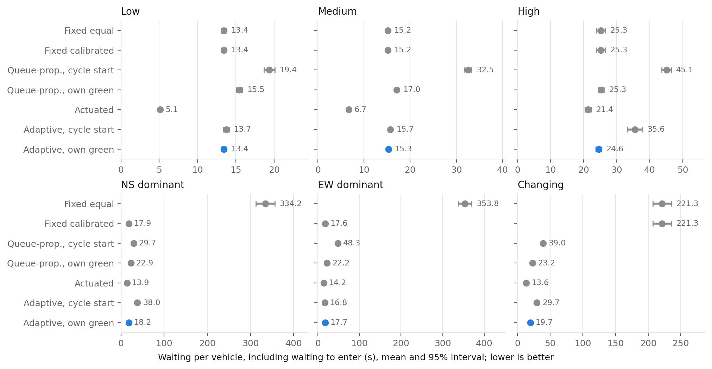
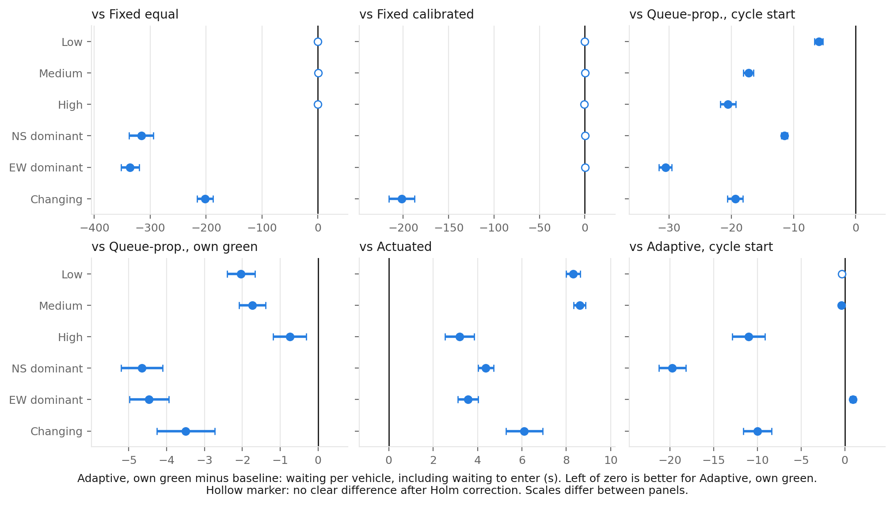
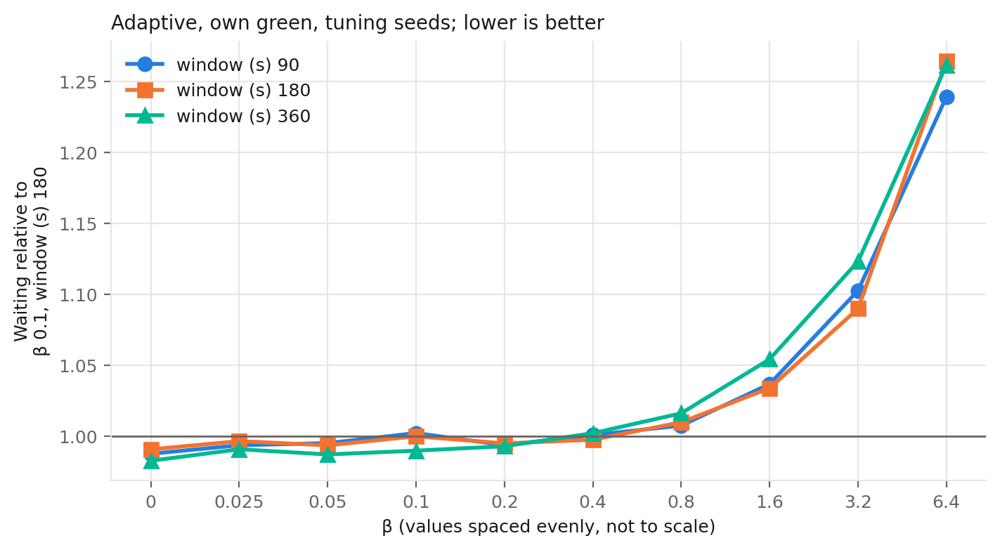
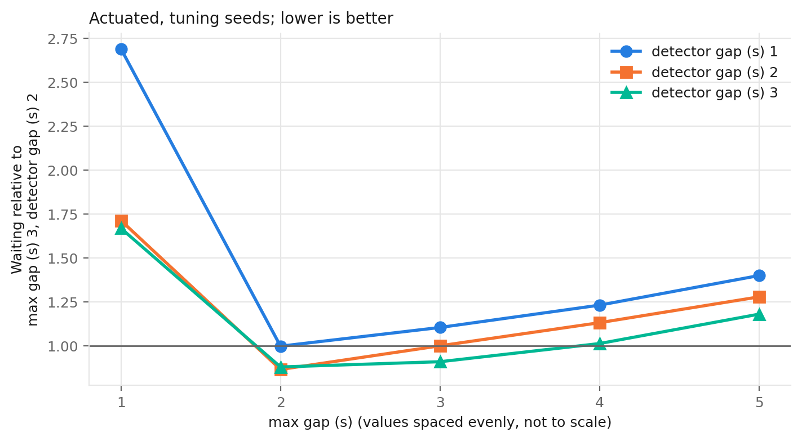

# Second Experiment Results

**Run:** 27 November 2026
**Environment:** SUMO 1.28.0, Python 3.12.1, 12 logical processors. Code fingerprint `b9599e6f7f92349b` ([environment](m9b/environment.json), [configuration](m9b/config.yaml)).

All results are about this simulation only. The tables are generated from the files in [m9b/](m9b/), copied from `results/m9b/`.

## What changed since the first experiment

1. **Own-green queue measurement (D8).** Each queue is read just before its own green; the East–West value is used at the next decision. The objective, solvers and signal sequence are unchanged.
2. **Actuated baseline.** SUMO's gap-based actuated signal, with the same green limits, yellow and all-red. Its cycle length varies; every other controller uses a fixed 90 s cycle.

The first change was proposed **after** seeing the [first results](M9_RESULTS.md). It was therefore evaluated on new traffic (seeds 201–220), against the old versions on that same traffic, with the [plan](../configs/experiments_m9b.yaml) fixed beforehand.

## Summary

- The measurement change **helped**: against the cycle-start version the adaptive controller waited clearly less in 4 scenarios (by 11 s, 20 s, 10 s and 0.4 s), clearly more in 1 (East–West dominant, +0.9 s), with no clear difference in low demand.
- It now **matches the demand-calibrated fixed signal** in 5 scenarios (no clear difference) and beats it clearly where demand changes, without being told the demand.
- It **beats queue-proportional control**, with either measurement, in all 6 scenarios.
- It **loses to the actuated signal in all 6**, by 3.2 to 8.6 s per vehicle.

## Method

- Seven controllers, six scenarios, seeds 201–220: 840 runs, 600 s warm-up and 3600 s measured, identical vehicles for a given scenario and seed.
- Primary metric as before: waiting per vehicle, including waiting to enter a full road.
- Proposed controller: adaptive with own-green measurement. Paired by seed, 95 % interval, Wilcoxon signed-rank test, Holm correction over the 36 comparisons of each metric.
- Tuning on seeds 1–5 only (below). The cycle-start adaptive controller keeps its first-experiment settings (β 1.6, window 90 s); both queue-proportional variants use a 90 s window.

## Run accounting

| Item | Count |
|---|---|
| Runs: completed / invalid / failed | 840 / 0 / 0 |
| Collisions, teleports | 0, 0 |
| Infeasible plans or greens applied | 0 |
| Adaptive solver calls converged | 9594 / 9600 |
| Solver calls stopped by the time limit (measured period / whole run) | 6 / 8 |
| Repeated runs reproducing all non-timing metrics | 7 / 7 |

### Decisions stopped by the time limit

8 solver calls, in 6 runs, ran out of wall-clock time. In 7 the decision was too late and the equal split was used; in 1 the partial answer was feasible, better than the start, and applied. These depend on how busy the computer was, so those runs cannot be expected to repeat exactly. The reported results are the originals. Repeating the 6 runs afterwards gave 0 time-limit stops and changed a run's waiting time by at most 0.73 s ([comparison](m9b/fallback_check.csv)). That moves any 20-seed mean by less than 0.1 s and changes no conclusion.

## Waiting time per vehicle (primary metric)

Seconds, mean ± half-width of the 95 % interval over 20 seeds. Lower is better; the best in each row is bold.

| Scenario | Adaptive, own green | Adaptive, cycle start | Queue-prop., own green | Queue-prop., cycle start | Actuated | Fixed calibrated | Fixed equal |
|---|---|---|---|---|---|---|---|
| Low | 13.4 ± 0.3 | 13.7 ± 0.4 | 15.5 ± 0.4 | 19.4 ± 0.7 | **5.1** ± 0.1 | 13.4 ± 0.3 | 13.4 ± 0.3 |
| Medium | 15.3 ± 0.3 | 15.7 ± 0.3 | 17.0 ± 0.4 | 32.5 ± 0.8 | **6.7** ± 0.1 | 15.2 ± 0.3 | 15.2 ± 0.3 |
| High | 24.6 ± 0.8 | 35.6 ± 2.3 | 25.3 ± 0.9 | 45.1 ± 1.5 | **21.4** ± 1.0 | 25.3 ± 1.3 | 25.3 ± 1.3 |
| NS dominant | 18.2 ± 0.4 | 38.0 ± 1.5 | 22.9 ± 0.7 | 29.7 ± 0.5 | **13.9** ± 0.5 | 17.9 ± 0.9 | 334.2 ± 21.9 |
| EW dominant | 17.7 ± 0.7 | 16.8 ± 0.7 | 22.2 ± 0.7 | 48.3 ± 1.2 | **14.2** ± 0.5 | 17.6 ± 0.7 | 353.8 ± 16.1 |
| Changing | 19.7 ± 0.7 | 29.7 ± 1.4 | 23.2 ± 0.9 | 39.0 ± 1.0 | **13.6** ± 0.5 | 221.3 ± 14.1 | 221.3 ± 14.1 |



### Adaptive (own green) minus each other controller

Negative means it waited less.

| Scenario | vs Adaptive, cycle start | vs Queue-prop., own green | vs Queue-prop., cycle start | vs Actuated | vs Fixed calibrated | vs Fixed equal |
|---|---|---|---|---|---|---|
| Low | -0.3 s (-2 %) no clear difference | -2.0 s (-13 %) better | -6.0 s (-31 %) better | +8.3 s (+163 %) worse | +0.0 s (+0 %) no clear difference | +0.0 s (+0 %) no clear difference |
| Medium | -0.4 s (-2 %) better | -1.7 s (-10 %) better | -17.2 s (-53 %) better | +8.6 s (+128 %) worse | +0.1 s (+1 %) no clear difference | +0.1 s (+1 %) no clear difference |
| High | -11.0 s (-31 %) better | -0.7 s (-3 %) better | -20.5 s (-45 %) better | +3.2 s (+15 %) worse | -0.7 s (-3 %) no clear difference | -0.7 s (-3 %) no clear difference |
| NS dominant | -19.7 s (-52 %) better | -4.7 s (-20 %) better | -11.5 s (-39 %) better | +4.4 s (+32 %) worse | +0.3 s (+2 %) no clear difference | -316.0 s (-95 %) better |
| EW dominant | +0.9 s (+6 %) worse | -4.5 s (-20 %) better | -30.6 s (-63 %) better | +3.6 s (+25 %) worse | +0.1 s (+1 %) no clear difference | -336.0 s (-95 %) better |
| Changing | -10.0 s (-34 %) better | -3.5 s (-15 %) better | -19.4 s (-50 %) better | +6.1 s (+45 %) worse | -201.6 s (-91 %) better | -201.6 s (-91 %) better |



| Compared with | Better | Worse | No clear difference |
|---|---|---|---|
| Adaptive, cycle start | 4 | 1 | 1 |
| Queue-prop., own green | 6 | 0 | 0 |
| Queue-prop., cycle start | 6 | 0 | 0 |
| Actuated | 0 | 6 | 0 |
| Fixed calibrated | 1 | 0 | 5 |
| Fixed equal | 3 | 0 | 3 |

## Did the measurement change do what was expected?

Means over the measured period. Pairs are North–South / East–West.

| Scenario | Queue used, cycle start | Queue used, own green | Green, cycle start | Green, own green |
|---|---|---|---|---|
| Low | 3.1 / 0.1 | 3.1 / 3.2 | 38.6 / 39.4 | 39.0 / 39.0 |
| Medium | 7.1 / 0.3 | 7.1 / 7.3 | 39.1 / 38.9 | 38.7 / 39.3 |
| High | 12.1 / 4.6 | 14.6 / 15.1 | 41.6 / 36.4 | 38.1 / 39.9 |
| NS dominant | 10.2 / 7.4 | 12.2 / 10.1 | 60.1 / 17.9 | 56.6 / 21.4 |
| EW dominant | 8.7 / 1.1 | 9.6 / 12.2 | 20.8 / 57.2 | 20.3 / 57.7 |
| Changing | 9.6 / 5.2 | 10.9 / 12.1 | 40.9 / 37.1 | 39.2 / 38.8 |

With equal demand the cycle-start readings are lopsided and the own-green readings are nearly equal, as predicted. In the equal-demand scenarios the green split moves to about half each.

The East–West dominant scenario got slightly worse in the main comparison; the next section shows why.

## Is it the measurement or the settings?

The corrected controller differs from the original in two ways: when it reads the queues, and its tuned β and window. A follow-up run of the two missing combinations (240 runs, same seeds) separates them. It was made after the results were known, and nothing was tuned or selected with it.

Waiting per vehicle (s). "Old" is β 1.6, window 90 s; "new" is β 0, window 360 s.

| Scenario | Cycle start, old (original) | Own green, old | Cycle start, new | Own green, new (corrected) | Effect of measurement, old settings | Effect of measurement, new settings |
|---|---|---|---|---|---|---|
| Low | 13.7 | 13.9 | 13.4 | 13.4 | +0.1 (not clear) | +0.0 (not clear) |
| Medium | 15.7 | 15.6 | 15.3 | 15.3 | -0.1 | -0.0 (not clear) |
| High | 35.6 | 24.6 | 43.0 | 24.6 | -10.9 | -18.4 |
| NS dominant | 38.0 | 21.2 | 33.6 | 18.2 | -16.8 | -15.4 |
| EW dominant | 16.8 | 19.3 | 25.1 | 17.7 | +2.5 | -7.3 |
| Changing | 29.7 | 20.2 | 33.3 | 19.7 | -9.4 | -13.6 |

Negative effects mean less waiting. "Not clear" means no clear difference after Holm correction over these 30 paired tests.

- **The measurement change accounts for the large gains.** In high, North–South dominant and changing demand it lowers waiting at either setting.
- **The new settings alone do not explain them:** at cycle-start measurement they make three scenarios worse.
- The two interact. In East–West dominant demand, own-green measurement is worse with the old settings and better with the new ones, so the small loss in the main comparison belongs to the combination, not to the measurement alone.
- In low and medium demand neither change matters in practice (under 0.5 s).

Three of the added runs had one solver call stopped by the time limit; each partial answer was applied. Data: [means](m9b/ablation_means.csv), [paired tests](m9b/ablation_summary.csv), [runs](m9b/ablation_runs.csv). Reproduce with `python scripts/ablation.py`.

## Why it matches the fixed signals in low demand

Tuning chose **β = 0**. When both predicted queues can be cleared, the objective is then zero over a range of splits and the controller keeps its starting point, the equal split. In low demand it behaves like the fixed equal signal (identical waiting times). It departs from it only when a queue is predicted to remain.

## The actuated signal

It is the best controller in every scenario. It reacts every second and ends a green when vehicles stop arriving, so its cycle is shorter in light traffic (108 cycles per measured hour in low demand against 40). The adaptive controller decides once per fixed 90 s cycle from a prediction. These differ in **both** the information used and the cycle length, so this experiment does not show which of the two explains the gap.

## Other metrics

Worst-approach delay (s):

| Scenario | Adaptive, own green | Adaptive, cycle start | Queue-prop., own green | Queue-prop., cycle start | Actuated | Fixed calibrated | Fixed equal |
|---|---|---|---|---|---|---|---|
| Low | 22.0 | 23.2 | 24.7 | 42.2 | **12.8** | 22.0 | 22.0 |
| Medium | 26.7 | 27.8 | 29.2 | 76.5 | **17.0** | 26.7 | 26.7 |
| High | 43.4 | 89.4 | 44.7 | 112.1 | **37.7** | 49.1 | 49.1 |
| NS dominant | 52.8 | 186.6 | 42.8 | 109.7 | **37.2** | 56.8 | 518.5 |
| EW dominant | 52.1 | 44.4 | 43.6 | 97.0 | **37.3** | 48.3 | 546.4 |
| Changing | 39.6 | 78.2 | 46.7 | 100.6 | **28.8** | 378.5 | 378.5 |

Average number of halted vehicles, all approaches:

| Scenario | Adaptive, own green | Adaptive, cycle start | Queue-prop., own green | Queue-prop., cycle start | Actuated | Fixed calibrated | Fixed equal |
|---|---|---|---|---|---|---|---|
| Low | 2.6 | 2.7 | 3.0 | 3.8 | **0.9** | 2.6 | 2.6 |
| Medium | 7.1 | 7.3 | 7.9 | 15.5 | **2.9** | 7.0 | 7.0 |
| High | 19.2 | 26.6 | 19.8 | 32.6 | **16.6** | 19.6 | 19.6 |
| NS dominant | 13.2 | 28.4 | 16.1 | 21.9 | **9.8** | 12.9 | 35.3 |
| EW dominant | 12.8 | 12.0 | 15.1 | 23.6 | **10.0** | 12.6 | 35.3 |
| Changing | 13.8 | 21.0 | 16.0 | 23.3 | **9.6** | 41.8 | 41.8 |

Stops per vehicle:

| Scenario | Adaptive, own green | Adaptive, cycle start | Queue-prop., own green | Queue-prop., cycle start | Actuated | Fixed calibrated | Fixed equal |
|---|---|---|---|---|---|---|---|
| Low | 0.55 | 0.55 | 0.56 | 0.60 | **0.53** | 0.55 | 0.55 |
| Medium | 0.63 | 0.63 | 0.66 | 0.95 | **0.60** | 0.63 | 0.63 |
| High | 0.91 | 1.13 | 0.93 | 1.32 | **0.75** | 0.92 | 0.92 |
| NS dominant | 0.75 | 1.04 | 0.92 | 0.92 | **0.65** | 0.74 | 1.63 |
| EW dominant | 0.74 | 0.74 | 0.92 | 1.27 | **0.67** | 0.75 | 1.64 |
| Changing | 0.80 | 0.94 | 0.94 | 1.12 | **0.64** | 1.75 | 1.75 |

Vehicles that left the network in the measured period:

| Scenario | Adaptive, own green | Adaptive, cycle start | Queue-prop., own green | Queue-prop., cycle start | Actuated | Fixed calibrated | Fixed equal |
|---|---|---|---|---|---|---|---|
| Low | 720 | 720 | **721** | **721** | 720 | 720 | 720 |
| Medium | 1716 | 1716 | 1716 | 1716 | **1717** | 1716 | 1716 |
| High | **2862** | 2855 | 2861 | 2857 | 2861 | 2861 | 2861 |
| NS dominant | 2718 | 2707 | 2718 | **2719** | 2716 | 2716 | 2340 |
| EW dominant | 2731 | 2731 | **2733** | 2732 | **2733** | **2733** | 2325 |
| Changing | 2709 | **2717** | 2705 | 2684 | 2710 | 2573 | 2573 |

Adaptive (own green) across metrics, as scenarios better / worse / no clear difference:

| Metric | vs adaptive, cycle start | vs queue-prop., own green | vs fixed calibrated | vs actuated |
|---|---|---|---|---|
| Waiting incl. entry (primary) | 4 / 1 / 1 | 6 / 0 / 0 | 1 / 0 / 5 | 0 / 6 / 0 |
| Total delay | 4 / 1 / 1 | 6 / 0 / 0 | 1 / 0 / 5 | 0 / 6 / 0 |
| Worst-approach delay | 5 / 1 / 0 | 3 / 2 / 1 | 2 / 0 / 4 | 0 / 6 / 0 |
| Stops per vehicle | 3 / 0 / 3 | 5 / 0 / 1 | 1 / 0 / 5 | 0 / 6 / 0 |
| Average queue | 4 / 1 / 1 | 6 / 0 / 0 | 1 / 0 / 5 | 0 / 6 / 0 |
| Throughput | 1 / 1 / 4 | 0 / 0 / 6 | 1 / 0 / 5 | 0 / 0 / 6 |

## Tuning (seeds 1–5)

| Controller | Settings tried | Chosen | Waiting relative to the starting values |
|---|---|---|---|
| Actuated | 15 | max gap 2 s, detector gap 2 s | 0.865 (starting: 3 s, 2 s) |
| Adaptive, own green | 30 | β 0, window 360 s | 0.983 (starting: β 0.1, 180 s) |

- **Both adaptive choices are at the edge of the grid.** β cannot be below 0. A window longer than 360 s was not tried; the grid was not extended because evaluation had already started when this was reviewed. The gain over the starting values is small (1.7 %) and nearby settings differ by little.
- β = 0 means the red-time term did not help here: the queue term alone gave the least waiting on the tuning seeds.
- The actuated settings gained 13 % over their starting values.





## Limitations

- One intersection, through movements only, perfect detection. The actuated signal places its detectors in the simulator, which is also idealized.
- The East–West value in own-green measurement is part of a cycle old.
- The measurement change was motivated by earlier results; new seeds guard against fitting to particular traffic, not against choosing the change after seeing where the design failed.
- Vehicles unfinished at the end are counted only up to the end.
- Differences below about 1 s are practically negligible even where statistically clear.

## Reproduce

```powershell
pip install -e ".[dev,sim,eval]"
python -m optitraffic.experiments --stage all    # plan: configs/experiments_m9b.yaml
```

With six parallel runs on the machine above, tuning took about 1.5 hours and evaluation about 1.2 hours. Finished runs are skipped. The frozen settings files in `configs/` are rewritten by the tuning stage.
