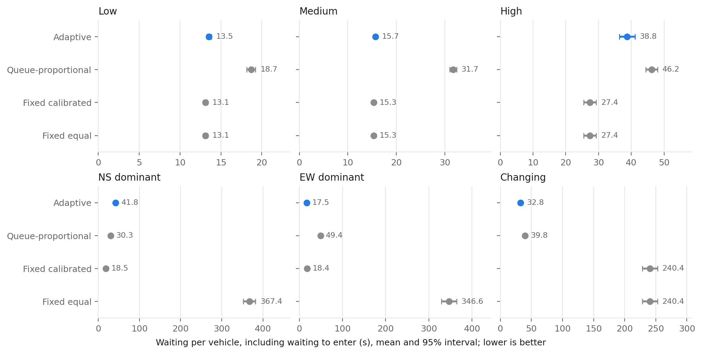
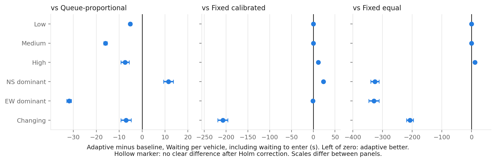
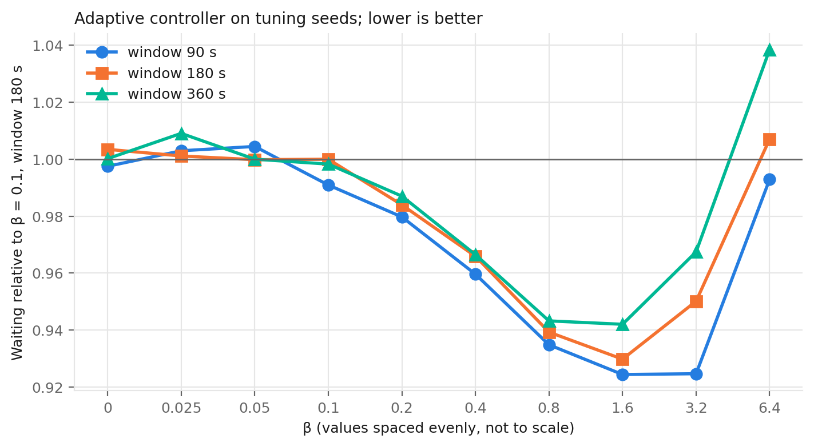
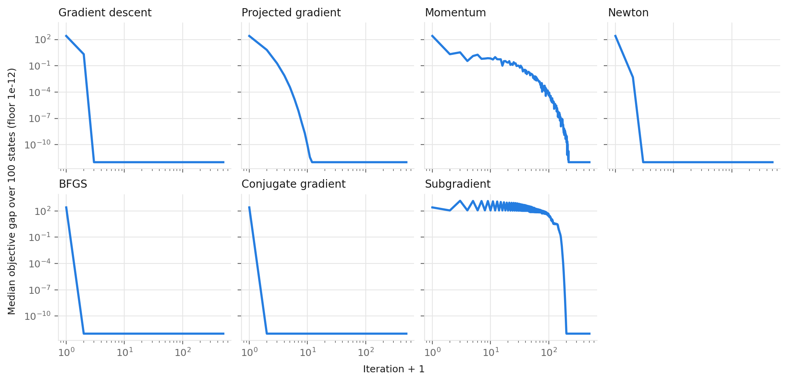
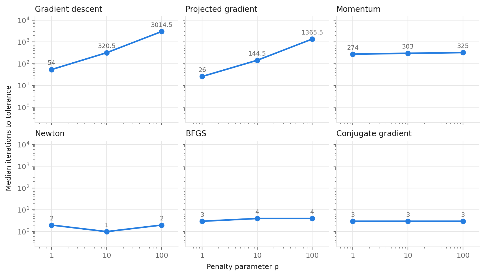

# M9 Results: Experiments

**Run:** 26–27 November 2026  
**Environment:** SUMO 1.28.0, Python 3.12.1, 12 logical processors. Code fingerprint `313643a7523655b0` ([environment](m9/environment.json), [configuration](m9/config.yaml)).

All results are about this simulation only. Every table below is generated from the files in [m9/](m9/), copied from `results/m9/`.

## Summary

- The optimization-based (adaptive) controller **beat the queue-proportional controller in 5 of 6 scenarios** on waiting time.
- Against the **fixed calibrated** signal it was **better in 2 and worse in 4** scenarios. Its large win is the changing-demand scenario, where one fixed split cannot work.
- Against the **fixed equal** signal it was better in the 3 unbalanced scenarios and worse in the 3 balanced ones.
- The likely main weakness is **when the queue is measured**, not the optimization: see [Why it loses](#why-it-loses).
- All seven deterministic solvers gave an optimal whole-second plan on every recorded state, so the choice among them does not change the signal.

## Method

- Four controllers, six scenarios, evaluation seeds 101–120: 480 runs, 600 s warm-up and 3600 s measured. Each controller received identical vehicles for a given scenario and seed.
- **Primary metric:** waiting time per vehicle, counting time halted on the road *and* time waiting to get onto a full road, for every vehicle scheduled in the measured period. Vehicles unfinished at the end count with their delay so far.
- Paired by seed: mean difference, 95 % confidence interval, Wilcoxon signed-rank test, Holm correction over the 18 comparisons of each metric.
- Parameters were tuned on seeds 1–5 and frozen before any evaluation run ([plan](../configs/experiments.yaml), [frozen values](../configs/frozen.yaml)).

## Run accounting

| Item | Count |
|---|---|
| Runs: completed / invalid / failed | 480 / 0 / 0 |
| Collisions, teleports | 0, 0 |
| Infeasible plans applied | 0 |
| Plans rejected by the validator | 0 |
| Fallbacks in the measured period | 0 |
| Fallbacks including warm-up (first cycle, no estimate yet) | 240 |
| Adaptive solver calls converged | 4800 / 4800 |
| Slowest solver call (6 runs in parallel) | 26 ms |
| Repeated runs reproducing all non-timing metrics | 6 / 6 |

## Waiting time per vehicle (primary metric)

Seconds, mean ± half-width of the 95 % interval over 20 seeds. Lower is better.

| Scenario | Adaptive | Queue-proportional | Fixed calibrated | Fixed equal |
|---|---|---|---|---|
| Low | 13.5 ± 0.3 | 18.7 ± 0.5 | 13.1 ± 0.2 | 13.1 ± 0.2 |
| Medium | 15.7 ± 0.3 | 31.7 ± 0.7 | 15.3 ± 0.2 | 15.3 ± 0.2 |
| High | 38.8 ± 2.4 | 46.2 ± 1.8 | 27.4 ± 1.9 | 27.4 ± 1.9 |
| NS dominant | 41.8 ± 2.4 | 30.3 ± 1.0 | 18.5 ± 1.2 | 367.4 ± 14.7 |
| EW dominant | 17.5 ± 1.1 | 49.4 ± 1.0 | 18.4 ± 1.3 | 346.6 ± 17.4 |
| Changing | 32.8 ± 1.9 | 39.8 ± 1.1 | 240.4 ± 12.3 | 240.4 ± 12.3 |



### Adaptive minus each baseline

Negative means the adaptive controller waited less. The largest Holm-adjusted p-value of the 18 comparisons is 0.0084.

| Scenario | vs queue-proportional | vs fixed calibrated | vs fixed equal |
|---|---|---|---|
| Low | -5.1 s (-28 %) better | +0.4 s (+3 %) worse | +0.4 s (+3 %) worse |
| Medium | -16.0 s (-50 %) better | +0.4 s (+3 %) worse | +0.4 s (+3 %) worse |
| High | -7.4 s (-16 %) better | +11.4 s (+42 %) worse | +11.4 s (+42 %) worse |
| NS dominant | +11.5 s (+38 %) worse | +23.3 s (+126 %) worse | -325.6 s (-89 %) better |
| EW dominant | -31.8 s (-65 %) better | -0.9 s (-5 %) better | -329.0 s (-95 %) better |
| Changing | -7.0 s (-18 %) better | -207.6 s (-86 %) better | -207.6 s (-86 %) better |



| Baseline | Adaptive better | Adaptive worse | No clear difference |
|---|---|---|---|
| Queue-proportional | 5 | 1 | 0 |
| Fixed calibrated | 2 | 4 | 0 |
| Fixed equal | 3 | 3 | 0 |

For equal demand, the calibrated split *is* the equal split, so those two columns are identical in the low, medium, high and changing scenarios.

## Other metrics

Worst-approach delay (s), time lost plus waiting to enter, on the approach that fared worst:

| Scenario | Adaptive | Queue-proportional | Fixed calibrated | Fixed equal |
|---|---|---|---|---|
| Low | 22.6 | 40.3 | 21.6 | 21.6 |
| Medium | 27.7 | 75.9 | 26.6 | 26.6 |
| High | 100.2 | 116.8 | 55.6 | 55.6 |
| NS dominant | 211.1 | 111.7 | 53.8 | 555.2 |
| EW dominant | 45.9 | 101.3 | 52.8 | 539.8 |
| Changing | 87.8 | 102.7 | 414.5 | 414.5 |

Waiting to enter a full road (s per vehicle):

| Scenario | Adaptive | Queue-proportional | Fixed calibrated | Fixed equal |
|---|---|---|---|---|
| Low | 0.5 | 0.5 | 0.5 | 0.5 |
| Medium | 0.6 | 0.6 | 0.6 | 0.6 |
| High | 3.0 | 4.8 | 1.3 | 1.3 |
| NS dominant | 1.5 | 1.6 | 1.4 | 323.1 |
| EW dominant | 1.3 | 17.9 | 1.5 | 301.6 |
| Changing | 3.1 | 9.1 | 185.6 | 185.6 |

Vehicles that left the network during the measured period:

| Scenario | Adaptive | Queue-proportional | Fixed calibrated | Fixed equal |
|---|---|---|---|---|
| Low | 726 | 726 | 726 | 726 |
| Medium | 1734 | 1736 | 1733 | 1733 |
| High | 2873 | 2881 | 2877 | 2877 |
| NS dominant | 2744 | 2757 | 2755 | 2330 |
| EW dominant | 2719 | 2722 | 2720 | 2337 |
| Changing | 2755 | 2727 | 2612 | 2612 |

Average number of halted vehicles, all approaches together:

| Scenario | Adaptive | Queue-proportional | Fixed calibrated | Fixed equal |
|---|---|---|---|---|
| Low | 2.7 | 3.7 | 2.6 | 2.6 |
| Medium | 7.4 | 15.3 | 7.2 | 7.2 |
| High | 29.1 | 33.7 | 21.2 | 21.2 |
| NS dominant | 31.4 | 22.4 | 13.3 | 35.3 |
| EW dominant | 12.4 | 24.2 | 13.0 | 35.3 |
| Changing | 23.2 | 23.9 | 43.3 | 43.3 |

Stops per vehicle:

| Scenario | Adaptive | Queue-proportional | Fixed calibrated | Fixed equal |
|---|---|---|---|---|
| Low | 0.54 | 0.59 | 0.54 | 0.54 |
| Medium | 0.64 | 0.93 | 0.63 | 0.63 |
| High | 1.19 | 1.33 | 0.98 | 0.98 |
| NS dominant | 1.12 | 0.94 | 0.77 | 1.63 |
| EW dominant | 0.75 | 1.29 | 0.75 | 1.64 |
| Changing | 1.00 | 1.13 | 1.77 | 1.77 |

Travel time, road waiting, total delay and maximum queue are in [means.csv](m9/means.csv) and [summary.csv](m9/summary.csv); finished, unfinished and never-entered vehicles per run are in [runs.csv](m9/runs.csv).

## Why it loses

The two phases do not look alike at the moment of decision. The state is read at the start of a cycle, just before North–South turns green: the North–South queue has been waiting through the whole East–West phase, while the East–West queue has just been served. With **equal** demand in both directions, the adaptive controller therefore sees a longer North–South queue and gives North–South more green:

| Scenario (equal demand) | Queue measured at decision, NS / EW | Mean green given (s), NS / EW | Average queue per approach, NS / EW |
|---|---|---|---|
| Low | 3.1 / 0.1 | 38.9 / 39.1 | 0.7 / 0.6 |
| Medium | 7.3 / 0.2 | 39.8 / 38.2 | 1.8 / 1.9 |
| High | 12.6 / 5.6 | 42.5 / 35.5 | 3.7 / 10.9 |

The model compares the two queues as if each had been measured at the same point of its own signal phase, which they were not.

Two further observations fit this explanation:

- The NS-dominant and EW-dominant scenarios are mirror images. The fixed calibrated signal treats them alike, but the adaptive controller waits 41.8 s in one and 17.5 s in the other. The tilt towards North–South pushes the NS-dominant case past the calibrated split (60.2 / 17.8 against 57.0 / 21.0), starving East–West. In the EW-dominant case it lands close to that split (21.7 / 56.3 against 21.0 / 57.0).
- The queue-proportional controller uses the same measurement and nothing else, and tilts further: with equal low demand it gives 55.5 / 22.5.

Greens are mean values in seconds, NS / EW.

This explanation was formed **after** seeing the evaluation results and has not been tested by changing the model. Other likely contributors are that a 90 s window makes arrival rates noisy, so green times swing from cycle to cycle, and that the fixed calibrated signal is given the true average demand.

Testing a correction (for example, measuring each queue just before its own green) would change the model. It would need a new experiment with **new evaluation seeds**; these results stand as the evaluation of the design as specified.

## Tuning (seeds 1–5)

900 runs over 30 settings of β and the observation window. Chosen: **β = 1.6, window 90 s**, 7.6 % less waiting than the starting values (geometric mean over scenarios). The first grid stopped at β = 0.8, which was also its best value, so it was extended on the same tuning seeds before any evaluation run.

| Scenario | β = 0.1, 180 s | β = 1.6, 90 s |
|---|---|---|
| Low | 13.4 | 13.6 |
| Medium | 15.9 | 16.1 |
| High | 45.5 | 36.3 |
| NS dominant | 34.9 | 39.1 |
| EW dominant | 23.8 | 16.7 |
| Changing | 31.9 | 30.9 |



- β matters more than the window. One setting does not suit all scenarios: high demand prefers a larger β, NS-dominant demand a smaller one.
- The best window is the smallest tried (one cycle); differences between windows are small near the best β.
- The baselines have no free parameters, so only the adaptive controller was tuned.

## Algorithm comparison

Run one at a time, no time budget, tolerance 1e-6, using the frozen model. Run times depend on the machine.

### T1: the control problem, 1380 states recorded in simulation (tuning seeds)

Start at an equal split. "Optimal plan" counts states where the rounded plan is a best whole-second plan.

| Objective | Solver | Converged | Median iterations | Max | Median ms | Max ms | Largest error (s) | Optimal plan |
|---|---|---|---|---|---|---|---|---|
| J | Gradient descent | 1380 / 1380 | 2 | 94 | 0.7 | 25 | 5.3e-06 | 1380 / 1380 |
| J | Projected gradient | 1380 / 1380 | 11 | 25 | 3.6 | 11 | 3.8e-06 | 1380 / 1380 |
| J | Momentum | 1380 / 1380 | 207 | 293 | 50.3 | 117 | 4.3e-06 | 1380 / 1380 |
| J | Newton | 1380 / 1380 | 1 | 3 | 0.8 | 6 | 0 | 1380 / 1380 |
| J | BFGS | 1380 / 1380 | 1 | 2 | 0.8 | 2 | 0 | 1380 / 1380 |
| J | Conjugate gradient | 1380 / 1380 | 1 | 8 | 0.7 | 7 | 0 | 1380 / 1380 |
| J | Subgradient | 1380 / 1380 | 148 | 327 | 23.7 | 64 | 3.4e-06 | 1380 / 1380 |
| J_ns | Subgradient | 1362 / 1380 | 72 | 500 | 15.0 | 105 | 0.068 | 1380 / 1380 |
| expected J | SGD (100 it.) | 0 / 100 | 100 | 100 | 24.1 | 27 | 4.2 | 89 / 100 |
| expected J | SGD (500 it.) | 0 / 100 | 500 | 500 | 118.2 | 131 | 1.3 | 100 / 100 |



- Newton, BFGS and conjugate gradient typically finish in one step, because the objective is piecewise quadratic in one variable. **This problem barely separates them** (decision D2).
- Momentum is the slowest smooth method here, with untuned settings.
- J_ns is a different objective with different minimisers; its values are not comparable with J. The subgradient method met the stopping test on 1362 of 1380 states and reached the iteration limit on the rest.
- SGD minimises the expected objective and never meets an exact test. Stopped at 100 iterations, as it is online, it chose an optimal whole-second plan in 89 of 100 states (largest error 4.2 s); at 500 iterations in 100 of 100.

### T2: two variables with a penalty, 200 states

Median iterations from an equal split (limit 20 000).

| Solver | ρ = 1 | ρ = 10 | ρ = 100 |
|---|---|---|---|
| Gradient descent | 54 | 320.5 | 3014.5 (3 failed) |
| Projected gradient | 26 | 144.5 | 1365.5 |
| Momentum | 274 | 303 | 325 |
| Newton | 2 | 1 | 2 |
| BFGS | 3 | 4 | 4 |
| Conjugate gradient | 3 | 3 | 3 |

Median violation of the cycle constraint: 21 s, 2.9 s and 0.32 s for ρ = 1, 10, 100. These solutions are never applied to signals.



Gradient descent and projected gradient slow roughly in proportion to ρ. Momentum barely changes. Newton, BFGS and conjugate gradient stay at a few iterations. The Newton reference solutions matched a grid search on all checked states.

### T3: test functions

Median iterations; quadratics are 20 random problems of 10 variables with condition number 10 or 100.

| Solver | Quadratic, cond. 10 | Quadratic, cond. 100 | Rosenbrock, 2 | Rosenbrock, 5 |
|---|---|---|---|---|
| Gradient descent | 127 | 1317 | not run | not run |
| Projected gradient | 57.5 | 600 | 11142 | 18728 |
| Momentum | 265 | 278 | not run | not run |
| Newton | 1 | 1 | 21 | 21 |
| BFGS | 10 | 10 | 22 | 24 |
| Conjugate gradient | 10 | 10 | 38 | 51 |

Gradient descent and momentum need a Lipschitz constant that Rosenbrock does not have globally. SGD needs sampled gradients, and the subgradient method is for nonsmooth problems; neither is included here.

## Limitations

- One intersection, through movements only, perfect detection, fixed 90 s cycle.
- 20 seeds per cell; the tests describe variation between seeds, not uncertainty about the model.
- Very small differences (under 1 s in the low and medium scenarios) are statistically clear but practically negligible.
- Vehicles unfinished at the end are counted only up to the end, which flatters controllers that leave long queues.
- The changing-demand calibrated baseline uses the average over both halves, so it equals the equal split.
- SUMO's actuated controller (optional) was not included.

## Reproduce

```powershell
pip install -e ".[dev,sim,eval]"
python -m optitraffic.experiments --stage all
```

`tune` and `evaluate` took about 50 and 25 minutes with six parallel runs. Finished runs are skipped. Results made with different code or configuration are refused rather than mixed; use a new `experiment_id`.
