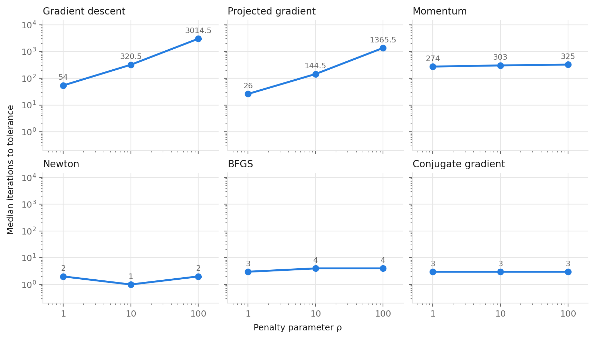
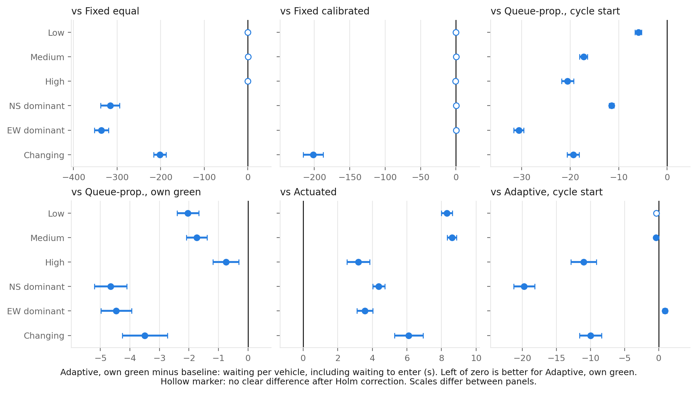

# OptiTraffic: Numerical Optimization of Green Times at a Signalized Intersection

**Type:** simulation study  
**Tools:** Python 3.12, NumPy, SUMO 1.28.0 with TraCI

All traffic results in this report come from a simulation. They say nothing certain about real roads.

---

## Abstract

At a four-way intersection with two signal phases, we choose the green time of each phase once per cycle by minimizing a convex, piecewise-quadratic function of the predicted queues. Eight optimization algorithms were implemented by hand and compared. On the resulting one-variable problem all deterministic methods find an optimal whole-second plan, so they differ in cost and not in the signal they produce; clear differences appear only when the same problem is made two-variable and ill-conditioned. In simulation, the first version of the controller lost to a fixed signal tuned to the demand in four of six scenarios. The cause was traced to when the queues were measured. After correcting it, and testing on new traffic, the controller was statistically indistinguishable from the tuned fixed signal in five scenarios without being told the demand, far better when demand changed, and better than queue-proportional control in all six. A standard actuated signal was better than it in every scenario.

---

## 1. Problem

Phase 1 serves North–South, phase 2 East–West. A cycle of length $C$ loses $L$ seconds to yellow, all-red and start-up, leaving a green budget $G=C-L$. Given for each phase the queue $q_i$ (veh), arrival rate $\lambda_i$ (veh/s) and discharge rate $\mu_i$ (veh/s):

$$\min_{g_1,g_2}\; J(g)=\sum_{i=1}^{2}w_i\,Q_i^2+\beta\sum_{i=1}^{2}\lambda_i(C-g_i)^2,\qquad Q_i=\max(0,\;q_i+\lambda_iC-\mu_ig_i)$$

$$\text{subject to}\quad g_1+g_2=G,\qquad g_{min}\le g_i\le g_{max}$$

The first term penalizes vehicles left waiting; squaring it penalizes imbalance between directions. The second is a proxy for the delay caused by long red periods.

| Quantity | Value | Source |
|---|---|---|
| Cycle $C$, lost time $L$, budget $G$ | 90 s, 12 s, 78 s | design and measurement |
| Green limits | 10 s to 70 s | design |
| Saturation flow | 1860 veh/h per lane | measured in the simulator: 1862 ([M3](M3_INTERSECTION.md)) |
| Weights $w_i$ | 1 | design |
| $\beta$, arrival-rate window | tuned | §5 |

The queue model counts vehicles over a whole cycle. It ignores *when* within the cycle they arrive, which matters in §6.

---

## 2. Analysis

Full derivations and worked examples are in [MATHEMATICS.md](MATHEMATICS.md); the formulas were checked numerically by 135 tests ([M1](M1_VERIFICATION.md)).

**Reduction.** Setting $g=g_1$ and $g_2=G-g$ gives $\varphi(g)=J(g,G-g)$ on the interval $[\ell,u]$, with $\ell=\max(g_{min},G-g_{max})$ and $u=\min(g_{max},G-g_{min})$.

**Derivatives.** Because $h(a)=\max(0,a)^2$ has $h'(a)=2\max(0,a)$ everywhere, $J$ is continuously differentiable:

$$\frac{\partial J}{\partial g_i}=-2w_i\mu_iQ_i-2\beta\lambda_i(C-g_i),\qquad \varphi'(g)=\frac{\partial J}{\partial g_1}-\frac{\partial J}{\partial g_2}$$

The second derivative jumps where a queue becomes zero, so $J$ is not twice differentiable.

**Convexity.** Each term is a convex function of an affine function, so $J$ and $\varphi$ are convex and every local minimum is global. A minimum exists because $\varphi$ is continuous on a closed interval. If $\beta(\lambda_1+\lambda_2)>0$, then $\varphi$ is strongly convex and the minimizer is unique. $\varphi'$ is Lipschitz with $L_\varphi=\sum_i(2w_i\mu_i^2+2\beta\lambda_i)$. If $\beta=0$ and both queues can be cleared, $\varphi$ is zero on a whole interval and a rule is needed to pick one point; we keep the starting point, the equal split.

**Optimality.** With projection $P(g)=\min(u,\max(\ell,g))$, a point is optimal exactly when $g^*=P(g^*-\varphi'(g^*))$. Testing $\varphi'=0$ would be wrong, because at a bound the derivative need not vanish. The KKT conditions are necessary and sufficient here, and the multiplier of $g_1+g_2=G$ is the value of one more second of green.

---

## 3. Algorithms

All are written from scratch; SciPy is used only in tests and statistics. Details in [SOLVERS.md](SOLVERS.md).

| Method | Update | Safeguard |
|---|---|---|
| Gradient descent | $P(x-\alpha\nabla f)$, $\alpha=1/L$ | fixed step |
| Projected gradient (used for control) | $P(x-t\nabla f)$ | Armijo search along the projection, $c=0.25$ |
| Momentum | heavy ball, coefficient 0.9 | restart if the objective rises |
| SGD | sampled arrivals, $\alpha_k=\alpha_0/(1+k)^{0.75}$ | seeded, tail averaging |
| Newton | damped, projected, generalized Hessian | gradient step if Hessian not positive definite |
| BFGS | inverse update | exact line search, skip bad curvature |
| Conjugate gradient | Polak–Ribière+ | restarts |
| Subgradient | $\alpha_k=\alpha_0/\sqrt{k+1}$, best iterate | iteration limit |

**Two objectives need separate treatment.** Since $J$ is differentiable, a subgradient method on it is only gradient descent, so the subgradient study also uses the nonsmooth $J_{ns}=\sum w_iQ_i+\beta\sum\lambda_i(C-g_i)^2$. SGD minimizes the *expected* value of $J$ when arrivals are Poisson; its optimum differs from the deterministic one because $h$ is convex (Jensen).

**Correctness.** Every solver is tested against an independent reference (grid search and bisection) and, where it exists, the known optimum. A finding from this testing: with the usual Armijo constant $10^{-4}$, projected gradient accepted steps close to $2/L$ and needed 569 iterations on one flat recorded state; with $c=0.25$ it needs 7.

---

## 4. Comparison of the algorithms

Run on the frozen model of the first experiment, tolerance $10^{-6}$ ([full tables](M9_RESULTS.md#algorithm-comparison)).

### 4.1 The real problem: 1380 traffic states from simulation

| Method | Converged | Median iterations | Optimal whole-second plan |
|---|---|---|---|
| Newton | 1380 / 1380 | 1 | 1380 / 1380 |
| BFGS | 1380 / 1380 | 1 | 1380 / 1380 |
| Conjugate gradient | 1380 / 1380 | 1 | 1380 / 1380 |
| Gradient descent | 1380 / 1380 | 2 | 1380 / 1380 |
| Projected gradient | 1380 / 1380 | 11 | 1380 / 1380 |
| Subgradient (on $J$) | 1380 / 1380 | 148 | 1380 / 1380 |
| Momentum | 1380 / 1380 | 207 | 1380 / 1380 |
| SGD, 100 iterations (expected $J$) | no exact test | 100 | 89 / 100 |

With one variable and a piecewise-quadratic objective, **the problem barely separates the methods**. The choice among converged solvers cannot change the traffic.

### 4.2 Ill-conditioning: two variables with a penalty

Replacing the equality constraint by $\tfrac{\rho}{2}(g_1+g_2-G)^2$ gives a two-variable problem whose condition number grows with $\rho$. Median iterations over 200 states:

| Method | $\rho=1$ | $\rho=10$ | $\rho=100$ |
|---|---|---|---|
| Gradient descent | 54 | 320.5 | 3014.5 (3 failed) |
| Projected gradient | 26 | 144.5 | 1365.5 |
| Momentum | 274 | 303 | 325 |
| Newton | 2 | 1 | 2 |
| BFGS | 3 | 4 | 4 |
| Conjugate gradient | 3 | 3 | 3 |



Gradient methods slow roughly in proportion to $\rho$; momentum is nearly unaffected; the methods using curvature need a few steps. The price of a small $\rho$ is a broken constraint: median violation 21 s, 2.9 s and 0.32 s.

### 4.3 Test functions

On random quadratics in 10 variables, Newton takes 1 step and BFGS and conjugate gradient take 10, as theory predicts; gradient descent needs 127 and 1317 at condition numbers 10 and 100. On the 2-variable Rosenbrock function, Newton, BFGS and conjugate gradient need 21, 22 and 38 iterations, projected gradient 11142. Two or ten variables say nothing about large-scale behaviour.

---

## 5. Experimental design

**Simulation.** One junction, one lane per approach, through traffic only, Poisson arrivals. Six scenarios: low, medium, high, North–South dominant, East–West dominant, and a demand that switches direction halfway. 600 s warm-up, then 3600 s measured. For a given scenario and seed every controller receives the same vehicles.

**Safety.** The signal always passes green, yellow, all-red in a fixed order and plans change only between cycles. Every plan is validated; an invalid or late one is replaced by the equal split and counted. The observed signal states are checked in tests.

**Controllers.**

| Controller | Rule |
|---|---|
| Fixed equal | half the budget each |
| Fixed calibrated | split in proportion to $\lambda_i/\mu_i$, **using the true average demand** |
| Queue-proportional | split in proportion to the queues |
| Actuated | SUMO's signal: extends a green while vehicles are detected; variable cycle |
| Adaptive (this work) | solves §1 each cycle with projected gradient |

**Measure.** The primary measure, fixed before evaluation, is waiting per vehicle *including time waiting to get onto a full road*, so that a signal cannot look good by keeping vehicles out.

**Statistics.** Parameters were tuned on seeds 1–5 and frozen. Evaluation used 20 other seeds. Differences are paired by seed, with 95 % confidence intervals, the Wilcoxon signed-rank test and Holm's correction for multiple comparisons.

Two experiments were run: the first (480 runs, seeds 101–120) and a second (840 runs, seeds 201–220).

---

## 6. Results

### 6.1 First experiment: the controller often lost

| Scenario | Adaptive | Queue-proportional | Fixed calibrated | Fixed equal |
|---|---|---|---|---|
| Low | 13.5 | 18.7 | **13.1** | **13.1** |
| Medium | 15.7 | 31.7 | **15.3** | **15.3** |
| High | 38.8 | 46.2 | **27.4** | **27.4** |
| NS dominant | 41.8 | 30.3 | **18.5** | 367.4 |
| EW dominant | **17.5** | 49.4 | 18.4 | 346.6 |
| Changing | **32.8** | 39.8 | 240.4 | 240.4 |

*Waiting per vehicle (s); best in bold.* The solver had converged at every decision, so the fault lay in the model or its inputs.

### 6.2 Diagnosis

Both queues were read at the start of the cycle, just before North–South turns green. At that moment North–South has waited through the whole East–West phase, while East–West has just been served. With equal heavy demand the controller measured about 12 against 5 vehicles and gave North–South more green than East–West.

**Correction.** Read each queue just before its own green; the East–West value is used at the next decision. The objective is unchanged. With equal heavy demand the readings became 14.6 and 15.1.

Because this idea came from looking at results, it was tested on **new** traffic, with the old version run beside it. The actuated signal was added at the same time.

### 6.3 Second experiment

| Scenario | Adaptive, corrected | Adaptive, original | Queue-prop., corrected | Actuated | Fixed calibrated | Fixed equal |
|---|---|---|---|---|---|---|
| Low | 13.4 | 13.7 | 15.5 | **5.1** | 13.4 | 13.4 |
| Medium | 15.3 | 15.7 | 17.0 | **6.7** | 15.2 | 15.2 |
| High | 24.6 | 35.6 | 25.3 | **21.4** | 25.3 | 25.3 |
| NS dominant | 18.2 | 38.0 | 22.9 | **13.9** | 17.9 | 334.2 |
| EW dominant | 17.7 | 16.8 | 22.2 | **14.2** | 17.6 | 353.8 |
| Changing | 19.7 | 29.7 | 23.2 | **13.6** | 221.3 | 221.3 |

*Waiting per vehicle (s); best in bold. The original queue-proportional controller (19.4 to 48.3 s) is in the [full results](M9B_RESULTS.md).*

**Which change did it?** The corrected controller also has newly tuned settings. A follow-up completing all four combinations ([table](M9B_RESULTS.md#is-it-the-measurement-or-the-settings)) shows that the measurement change produces the large gains: with the settings held fixed it lowers waiting in high demand by 10.9 s (old settings) and 18.4 s (new), and in North–South dominant demand by 16.8 s and 15.4 s. The new settings alone make three scenarios worse.



| Corrected adaptive controller compared with | Better | Worse | No clear difference |
|---|---|---|---|
| Original adaptive | 4 | 1 | 1 |
| Queue-proportional, corrected | 6 | 0 | 0 |
| Fixed calibrated | 1 | 0 | 5 |
| Fixed equal | 3 | 0 | 3 |
| Actuated | 0 | 6 | 0 |

All 840 runs were valid, with no collisions, and 7 repeated runs reproduced their measurements. Eight solver calls hit the 0.1 s wall-clock limit; repeating the affected runs changed no conclusion ([details](M9B_RESULTS.md#run-accounting)).

---

## 7. Discussion

1. **A correct optimizer is not enough.** The solvers were right in both experiments. The large improvement came from measuring the input consistently with the model.
2. **Where optimization helps.** Against fixed signals the gain is large only when demand is unbalanced or changes. For steady demand, a fixed split chosen with knowledge of that demand is as good.
3. **Objective matters more than algorithm.** On this problem every deterministic method gives the same signal. Replacing queue-proportional splitting by optimization, using the same queue measurements (plus the arrival rates the model needs), lowered waiting by 0.7 to 4.7 s.
4. **The red-time term did not help.** Tuning the corrected controller chose $\beta=0$, leaving only the squared queues. The controller then returns the equal split whenever both queues can be cleared, which explains why it matches the fixed equal signal in low demand. In the first experiment, with biased measurements, tuning had chosen $\beta=1.6$.
5. **The actuated signal is better.** It reacts every second and shortens its cycle in light traffic, while our controller commits to a 90 s cycle from a prediction. Both differences act together, so this study cannot say how much each contributes.

---

## 8. Limitations

- One intersection, one lane per approach, no turning traffic, pedestrians or emergency vehicles.
- Perfect detection, including vehicles waiting outside a full road.
- Fixed cycle length and one-cycle lookahead; arrivals within a cycle are ignored.
- The red-time term is a proxy for delay, not a delay formula.
- Both tuned values of the corrected controller ($\beta=0$, window 360 s) lie at the edge of the searched grid; a longer window was not tried. The gain from tuning it was under 2 %.
- The correction was motivated by earlier results. New seeds protect against fitting to particular traffic, not against choosing a change after seeing where the design failed.
- Vehicles unfinished at the end are counted only up to the end.
- Twenty seeds describe variation between traffic samples, not uncertainty about the model.

## 9. Conclusion and further work

Numerical optimization chooses green times reliably and cheaply: the control problem is convex and solved in milliseconds. Its value for traffic depends on the model's inputs. With consistent queue measurement the controller matched an informed fixed signal under steady demand, adapted when demand changed, and beat a simple heuristic, but it did not reach a standard actuated signal.

Natural next steps, each needing a new experiment: a variable cycle length; optimizing several cycles together, which gives a larger, convex but nonsmooth problem ([§16](MATHEMATICS.md#16-optional-extension-several-cycles)); predicting each queue at the start of its green instead of using the last reading; and a wider tuning grid.

---

## 10. Reproducing the results

```powershell
py -3.12 -m venv .venv
.\.venv\Scripts\Activate.ps1
pip install -e ".[dev,sim,eval]"
python scripts/reproduce_headline.py     # one headline result, a few minutes
```

The [README](../README.md#reproduce-the-results) gives the commands for the full experiments.

## References

1. S. Boyd and L. Vandenberghe, *Convex Optimization*, Cambridge University Press, 2004.
2. J. Nocedal and S. J. Wright, *Numerical Optimization*, 2nd ed., Springer, 2006.
3. P. A. Lopez et al., "Microscopic Traffic Simulation using SUMO", *IEEE International Conference on Intelligent Transportation Systems*, 2018.
